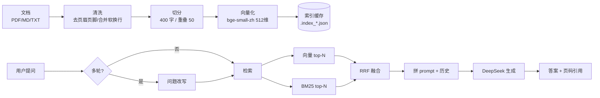

# RAG Handbook QA ｜ 文档问答系统

> 给企业文档做一套能落地的问答：**先检索原文，再让模型作答，答案带页码引用；查不到就说查不到。**

不依赖任何 RAG 框架，核心检索与生成逻辑约 400 行 Python，便于二次改造。


<!-- 把截图放到 docs/screenshot-chat.png；没有就先删掉这一行 -->

---

## 解决什么问题

企业内部文档（员工手册、SOP、制度汇编）有三个痛点：

| 痛点 | 现象 |
|---|---|
| 找不到 | 两百页 PDF，Ctrl+F 只认字面，问"年假能攒到明年吗"搜不出来 |
| 不敢信 | 通用大模型会一本正经地编造条款 |
| 不好交接 | 答案没有出处，员工拿去和 HR 对线没法举证 |

这套系统的做法：

1. 把文档切块、向量化，**检索最相关的几段原文**
2. 把原文塞给模型，**要求它只依据原文回答**
3. 每个结论都带 **`[1]` 编号 → 对应到具体页码**
4. 原文没有的，**明确回答"资料中未找到"**，不编
5. 多轮追问支持**自动改写问题**（"它和病假能叠加吗" → "年假和病假能叠加吗"）

---

## 特性

- **PDF / Markdown / TXT** 三种格式，PDF 引用精确到页（跨页条款自动合并）
- **混合检索**：向量（BGE-small-zh）+ BM25 关键词，RRF 融合
- **引用可核对**：答案是 `[1][2]`，界面可展开看原文片段
- **拒答机制**：知识库没有就说没有，并指出缺哪类信息
- **抗提示词注入**：拒绝扮演、拒绝吐系统提示（提示词 + 代码双层）
- **索引落盘**：文档不变时启动不重算（26 块 1 秒 → 0.1 秒）
- **多轮对话**：每个浏览器会话独立上下文
- **一键部署**：本地 `streamlit run` 或 `docker compose up`

---

## 架构



---

## 快速开始

### 方式一：本地运行

```bash
# 1. 依赖
python -m venv .venv
.venv\Scripts\activate        # Windows
pip install -r requirements.txt

# 2. 配置 API Key（DeepSeek，OpenAI 兼容接口）
copy .env.example .env        # 或直接写 key.txt
# 把 key 填进 key.txt 或环境变量 DEEPSEEK_API_KEY

# 3. 启动
streamlit run app.py
```

浏览器打开 http://localhost:8501

> VS Code 用户：仓库自带 `.vscode/launch.json`，按 **F5** 选 `RAG Web (Streamlit)` 即可，会自动读 `key.txt`。

> 首次运行会下载向量模型（约 100MB）。国内直连 huggingface 失败时，程序会**自动切到 hf-mirror** 重试，无需手动配置。

### 方式二：Docker

```bash
echo DEEPSEEK_API_KEY=sk-xxxx > .env
docker compose up -d --build
```

首次启动会下载向量模型（约 100MB），之后缓存在 Docker 卷里。

### 命令行

```bash
python rag.py                      # 交互式，支持连续追问
python rag.py "年假有几天"          # 单次提问
python rag.py --debug "年假有几天"  # 显示检索到的片段与相似度
python rag.py --rebuild "问题"      # 强制重建索引
```

---

## 配置

`rag.py` 顶部的 `CONFIG` 是唯一需要改的地方：

| 参数 | 默认 | 说明 |
|---|---|---|
| `chunk_size` | 400 | 每块字符数。实测 400 字 ≈ 300 token，模型上限 512，超过约 650 字会被静默截断 |
| `overlap` | 50 | 相邻块重叠，防止一句话被切断 |
| `top_k` | 3 | 检索条数 |
| `hybrid` | True | 是否启用 BM25 混合检索 |
| `rewrite` | True | 多轮是否改写问题（关掉可省一次 API 调用） |
| `history_rounds` | 3 | 记住最近几轮对话 |

---

## 评测

评测脚本：`eval_v2.py`（要点覆盖 + 引用正确）、`eval_hybrid.py`（检索策略对比）。

### 检索策略对比（8 题，数字类查询为主）

| 模式 | 要点正确 | 引用正确 |
|---|---|---|
| 纯向量 | 7/8（88%） | 7/8 |
| **混合检索** | **8/8（100%）** | **8/8** |

**唯一失败的那道题最能说明问题**：

> 问：月薪折算日工资的系数是多少？
> 纯向量 → 「资料中未找到相关内容」
> 混合检索 → 「21.75」✅

`21.75` 这类数字，向量模型抓不到精确匹配，BM25 一搜就有。

### 切分参数对比（11 题）

| 配置 | 块数 | 要点覆盖 | 引用正确 |
|---|---|---|---|
| 400/50/3 | 44 | 100% | 11/11 |
| 200/50/5 | 113 | 100% | 11/11 |

> 说明：上述数字来自一份 12 页的企业员工手册（未随仓库分发，涉版权）。
> 仓库内 `docs/sample-handbook.md` 是虚构示例，clone 后可直接跑通；换成自己的 PDF 即可复现同类评测。

---

## 设计决策

**1. 不用 LangChain**
先把检索、切分、拼 prompt 手写一遍，才知道每个环节在干什么。之后换任何框架都是替换实现，不是重新学习。

**2. 切分按"句末标点回退"**
硬切 400 字会把句子劈开。做法是：先取 400 字，再往回找最近的 `。？！；` 或换行，把边界挪过去，最多回退 150 字。

**3. 混合检索而不是堆模型**
向量擅长语义，BM25 擅长数字、编号、专有名词。用 RRF 融合两者排名（只比排名不比分数，避免两套分数量纲不可比）。

**4. 拒答 + 引用 + 抗注入**
- 拒答：知识库没有的，宁可说不知道
- 引用：每个结论后必须带编号，界面可展开核对原文
- 抗注入：提示词层面禁止泄露系统配置，代码层面再兜一层（`_guard_leak`）

---

## 项目结构

```
rag-lab/
├── app.py                 # Streamlit 界面
├── rag.py                 # 核心：清洗/切分/向量/检索/生成
├── eval_v2.py             # 评测：要点覆盖 + 引用正确
├── eval_hybrid.py         # 评测：纯向量 vs 混合检索
├── reports/               # 评测报告
├── docs/                  # 语料（含虚构示例手册）
├── Dockerfile
├── docker-compose.yml
└── requirements.txt
```

---

## 已知限制

- **不处理扫描件**：PDF 需要可提取文字，扫描版要自己先做 OCR
- **单进程**：会话隔离靠 Streamlit 的 session，重启即丢，没有持久化账号体系
- **无增量索引**：改一个文件会全量重建（26 块无所谓，几千块会明显变慢）
- **无向量数据库**：用的是 numpy 暴力检索，语料 > 500 页建议换 pgvector
- **成本按字符估算**：没有精确统计 token
- **中文分词按字切**：BM25 用的字符级切分，没有引入分词器

---

## Roadmap

- [ ] 增量索引（只重算变化的文档）
- [ ] pgvector 存储，支持大语料
- [ ] 重排（bge-reranker）对比实验
- [ ] 多文档集合与权限隔离
- [ ] 答案成本统计（token / 金额）

---

## 技术栈

`Python 3.12` · `Streamlit` · `fastembed (ONNX)` · `BAAI/bge-small-zh-v1.5` · `rank_bm25` · `DeepSeek API` · `pypdf` · `Docker`

---

## License

[MIT](LICENSE)
